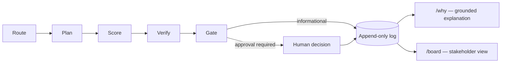

<div align="center">

# Retail Decision Intelligence Agent

> **Part 3 of the Dunnhumby series** — [Part 1: Store Performance Analysis](https://github.com/ashishkumar-ds/data-science-projects/tree/main/dunnhumby-retail-performance-analysis) proved what works · [Part 2: Campaign Automation](https://github.com/ashishkumar-ds/retail-campaign-automation-with-n8n) scaled it across 85 stores · **this project decides what's next per store.**

**A deterministic agent for retail store recovery. The brain is code, not a model call: every recommendation is recomputable by hand, citable by ID, and approved by a human before any budget moves. A Groq LLM layer explains the evidence; it never decides.**

[Live demo](#demo) · [Quickstart](#quickstart) · [API](#api-surface) · [Configuration](#configuration) · [Docs](#documentation)

[](https://github.com/ashishkumar-ds/retail-decision-intelligence-agent/actions/workflows/ci.yml)
[](https://www.python.org)
[](docs/DEPLOYMENT.md#hosted-llm-the-two-ceilings)
[](https://retail-decision-intelligence-agent.vercel.app/)
[](https://retail-decision-intelligence-agent.onrender.com/health)
[](https://supabase.com)

**Live:** [stakeholder board](https://retail-decision-intelligence-agent.vercel.app/) (Vercel) · [API](https://retail-decision-intelligence-agent.onrender.com/health) (Render — `/health`, `/docs`, `/openapi.json`). Writes need a bearer token, else 503. Render's free tier sleeps: the first load wakes it (~30–60s; the footer shows "API waking") — cold start, not downtime.

**Reviewer's path (about 5 minutes):** [`decision_engine/scorer.py`](decision_engine/scorer.py) — the recommendation you can recompute by hand → [the approval-and-write gates in `app/main.py`](app/main.py) → [`analytics/decision_quality.py`](analytics/decision_quality.py) — what the recorded decisions returned → [the six ADRs](docs/adr/): pure-code path, append-only records, asymmetric failures, golden cases, egress redaction, off-path LLM measurement.

> **Non-negotiables** (enforced in CI, not aspirations): decisions are pure code, recomputable and citable; budget moves only behind human approval; missing evidence fails closed; the LLM stays off the decision path.

</div>

## Demo

**Local demo:** no keys, no services — one command runs the whole loop on recorded data:

```bash
bash scripts/seed_demo.sh
```

The hosted demo enables the off-path Groq layer with per-IP and daily caps.


Then open `/why/317` for a grounded, cited EXTEND_INTERVENTION, or `/board` for the full portfolio. Full walkthrough: [DEMO.md](DEMO.md).

## What it is

A deterministic retail decision agent for underperforming stores. The brain is pure code, every recommendation is recomputable and citable, causal DiD evidence gates scale-up **and any spend move** (own-baseline lift alone never starts or moves spend — it is operational signal, not proof), and a human must approve any budget-moving action. Explanations ground every number in cited evidence, and 23 pinned golden scenarios gate any behavior change in CI.

**Core invariant:** the LLM never decides, never changes numbers, and never bypasses the human gate — it only rephrases grounded, cited evidence and drafts human-gated advisory suggestions.

**For data-science / AI-ML roles:** measurement over vibes — every claim carries a confidence and a citation, and model-style evals gate every change.

## What this demonstrates

- Deterministic decision systems under uncertainty — pure-code engine, no model calls on the decision path
- Causal measurement in production-style loops — DiD with treated-vs-control assessment gating scale-up and spend moves (CI lower bound / MDE can downgrade CONFIRMED to review zone)
- Human-in-the-loop safety for budget actions — double-gated approvals, fail-closed everywhere
- Evaluation as a first-class citizen — 23 pinned golden scenarios + grounding-failure and provider-swap evals in CI
- Off-path LLM engineering — Groq/OpenAI-compatible or Anthropic, grounding/citation guards, fail-closed templates, and per-IP + daily spend caps

## Quickstart

Requires Python 3.15 (the version CI tests).

```bash
git clone https://github.com/ashishkumar-ds/retail-decision-intelligence-agent.git
cd retail-decision-intelligence-agent

python -m venv .venv && source .venv/bin/activate
pip install -e ".[dev]"

pytest
uvicorn app.main:app --port 8001
```

Same gates CI runs:

```bash
ruff check .
python scripts/check.py
python evaluation/run_evals.py  # 23 golden business scenarios
python evaluation/reliability_report.py  # health/confidence reliability, offline (not a CI gate)
```

Deploy with Docker: see [docs/DEPLOYMENT.md](docs/DEPLOYMENT.md) (always-on host + persistent disk; unset variables keep silent defaults, sweep stays off unless enabled).

## How a decision is made

Every store evaluation runs a fixed pipeline — `route → plan → score →
verify → approval gate` — with each stage recorded in a `DecisionTrajectory`
embedded in the recommendation record itself.



The off-path LLM layer has two jobs: rephrase grounded, cited evidence for `/why/{store_id}`, and draft a human-gated triage suggestion for `/advisory/{store_id}`. The decision path itself is pure code with no model calls.


*Pure-code decision path → human gate → append-only log; the off-path LLM only rephrases evidence and drafts advisory notes. Decision path only — infra (Render, Supabase, disk) is in [Deployment](docs/DEPLOYMENT.md).*


### The off-path LLM layer

`/why/{store_id}` rephrases grounded, cited evidence; `/advisory/{store_id}` drafts a triage note from the engine's own closed vocabulary. Both are off-path and optional at runtime: without a key or with the flags off, they serve the deterministic template, and every failure degrades there too. Calls are capped per caller per hour and per account per day. The published demo uses Groq through the OpenAI-compatible adapter (`qwen/qwen3.8-27b`); set `LLM_PROVIDER=anthropic` for Claude. Groq needs no extra SDK — `httpx` is already a runtime dependency.

## API surface

Core decision endpoints:

| Endpoint | Method | Purpose |
| --- | --- | --- |
| `/health` | GET | Liveness + sweep-scheduler status |
| `/board`, `/why/{store_id}` | GET | Stakeholder board · grounded, cited explanation |
| `/advisory/{store_id}` | GET | Off-path LLM triage note; grounded in engine evidence, human-gated, fail-closed |
| `/recommendations` | GET | Latest recommendations (read-only) |
| `/recommendations/run` | POST | Recompute and persist (auth) |
| `/approve/{store_id}`, `/reject/{store_id}`, `/execute/{store_id}` | POST | Human decision + gated execution (auth) |
| `/pending-approvals`, `/attention-queue` | GET | Approval queue and triage digest |

Intervention lifecycle (Phase 2) / analytics / ops:

| Endpoint | Method | Purpose |
| --- | --- | --- |
| `/phase2/interventions/*`, `/phase2/portfolio/evaluate` | GET/POST | Intervention lifecycle + portfolio evaluation (auth on writes) |
| `/analytics/decision-quality` | GET | Acceptance, causal confirmation, margin per intervention, health/confidence reliability (auth) |
| `/metrics` | GET | Prometheus metrics (auth; see ops/observability/) |
| `/log` | GET | Append-only recommendation log + decision ledger (auth; raw audit trail, not the stakeholder view) |

All writes need `Authorization: Bearer <token>` from `APPROVAL_AUTH_TOKEN` (or a named `APPROVAL_TOKENS` entry). Unset token → 503, fail closed.

> **Auth:** named tokens with roles, per-token expiry, and short-lived HMAC-signed tokens (`scripts/issue_token.py`, rotation via overlap secret). No OIDC federation — the remaining step for enterprise SSO.

## Configuration

| Variable | Default | Purpose |
| --- | --- | --- |
| `APPROVAL_AUTH_TOKEN` | unset (fail-closed) | Bearer token for all write paths |
| `FORECAST_API_URL` | deployed forecast API | Shared forecast service |
| `CAMPAIGN_AUDIT_API_URL` | unset | Project 2 read-only audit log (store universe source) |
| `DATABASE_URL` | unset (SQLite) | `postgres://` URL selects Postgres (Supabase session pooler + `?sslmode=require`) for the pending-approval store — durable, multi-instance safe. JSONL audit logs still need the disk |
| `SWEEP_ENABLED` / `SWEEP_INTERVAL_SECONDS` | off / `86400` | Opt-in background sweep scheduler |
| `LLM_ADVISORY_ENABLED` / `LLM_EXPLANATIONS_ENABLED` | off / off (on in the published demo) | Off-path LLM layers; optional at runtime — without a key or with the flags off, both endpoints serve the deterministic template |
| `LLM_PROVIDER` / `LLM_BASE_URL` / `LLM_MODEL` / `LLM_API_KEY` | `anthropic` / — / `claude-sonnet-4-5` / unset | Provider for the off-path LLM. For Groq: `openai_compat` + `https://api.groq.com/openai/v1` + a Groq key. No key → deterministic template. `LLM_API_KEY` is a secret. |
| `LLM_PER_IP_HOURLY_LIMIT` / `LLM_DAILY_CALL_BUDGET` | `20` / `250` | Spend caps for the two public LLM endpoints (`/why/{store_id}`, `/advisory/{store_id}`); `0` = unlimited |
| `PORT` | `8001` | FastAPI listen port |

Full list with comments: [`.env.example`](.env.example) (a test fails if code reads an undocumented variable).

## Documentation

- [Whitepaper](docs/WHITEPAPER.md) — the P1 → P2 → P3 series and this agent's place in it
- [Safety](docs/SAFETY.md) — every safety gate, its rule, and failure mode
- [Hosted LLM: the two ceilings](docs/DEPLOYMENT.md#hosted-llm-the-two-ceilings) — Groq/Anthropic setup, grounding gates, fail-closed behavior, and spend caps
- [LLM integration patterns](docs/LLM_INTEGRATION_PATTERNS.md) — reference checklist for keeping the LLM off the decision path
- [Market benchmark](docs/market_benchmark_retail_di.md) — positioning against commercial retail-DI platforms
- [Deployment](docs/DEPLOYMENT.md) — Render + Supabase setup, durable-storage trade-offs
- [Frontend contract](docs/FRONTEND_CONTRACT.md) — board spec for the Vercel surface (reads plus one token-gated approve)
- [Off-path classifiers — classifier.dev / Jev](https://classifier.dev) — keep-biased RAG pre-filter + root-cause tags, keyless; numbers redacted before egress, failures degrade safe ([ADR-0005](docs/adr/0005-redact-numbers-before-egress.md))

Further depth lives in [`docs/`](docs/) unlinked (architecture decision records in `docs/adr/`, specs, deployment notes).

## Limitations

- **No OIDC federation**: short-lived HMAC tokens cover service-to-operator auth; enterprise SSO still needs an identity provider.
- **Execution adapter is operator-selected** (`EXECUTION_CONNECTOR=webhook` + URL for real writes, dry-run when unset): `execution/webhook_connector.py` proves the path with remote handles journaled; a production POS/CRM adapter implements the same two methods.
- **Retrieval is lightweight**: hand-rolled BM25 over a curated corpus — context for explanations, never authority for decisions.
- **Causal evidence is opt-in**: without matched-control coverage the guardrail is `UNAVAILABLE` and scale-up **plus all spend moves** (retarget / timing-shift / reallocate) stay blocked; own-baseline lift is operational signal, not proof. A target-clearing point whose CI-95 admits zero (or sits below MDE) lands review zone, not confirmed.
- **Confidence and the health score are heuristics, not calibrated probabilities**: `compute_health_score` uses hand-set weights and `_boundary_confidence` a fixed distance from the band edges, so `0.85` is a ranking device, not a frequency. No reliability curve or Brier score is computed yet — read the number as an ordering, not a probability.
- **The treatment effect is one campaign in one retailer's data (n=1)**: the DiD prior is `+2.84%` with a 95% CI of `[−0.5, +6.2]`, which admits zero, so the guardrail blocks the spend instead of dressing the estimate up. More of the same data will not fix a power problem — randomization (the roadmap's experiment engine) will.
- **Single-retailer scope**: JSONL audit log + optional Postgres suit one portfolio; multi-tenant use needs warehouse separation and forecast-call cost controls.

## Contributing

Keep the decision path deterministic: a change that alters a recommendation
must update the pinned golden cases in the same commit, with the rationale
stated. Run `ruff check .`, `pytest`,
`python scripts/check.py` and `python evaluation/run_evals.py`
before opening a PR — CI runs all of them plus a Docker build smoke test.
The default suite is offline: live smoke tests run only via `pytest -m live_api`, so a regular `pytest` never calls the deployed APIs.

## License

MIT — see [LICENSE](LICENSE).
