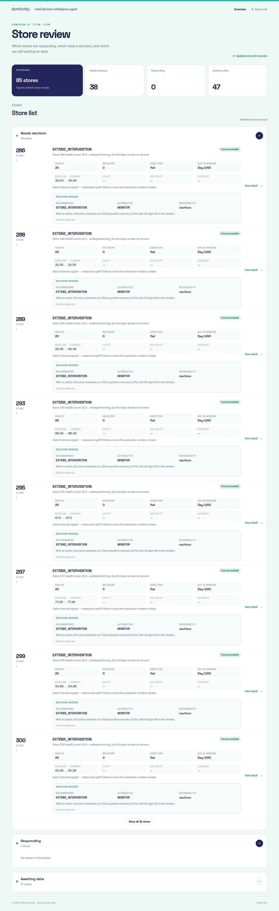
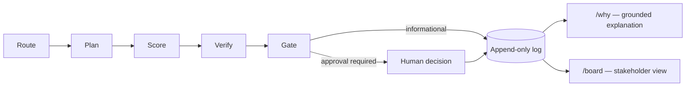
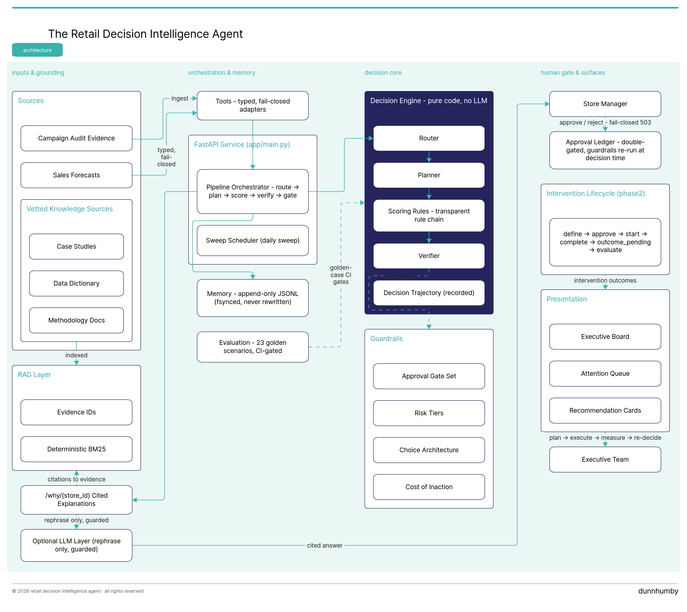

<div align="center">

# Retail Decision Intelligence Agent

> **Part 3 of the Dunnhumby series** — [Part 1: Store Performance Analysis](https://github.com/ashishkumar-ds/data-science-projects/tree/main/dunnhumby-retail-performance-analysis) proved what works · [Part 2: Campaign Automation](https://github.com/ashishkumar-ds/retail-campaign-automation-with-n8n) scaled it across 85 stores · **this project decides what's next per store.**

**A deterministic agent for retail store recovery. The brain is code, not a model call: every recommendation is recomputable by hand, citable by ID, and approved by a human before any budget moves.**

[Live demo](#demo) · [Quickstart](#quickstart) · [API](#api-surface) · [Configuration](#configuration) · [Docs](#documentation)

[](https://github.com/ashishkumar-ds/retail-decision-intelligence-agent/actions/workflows/ci.yml)
[](https://www.python.org)
[](LICENSE)
[](https://retail-decision-intelligence-agent.vercel.app/)
[](https://retail-decision-intelligence-agent.onrender.com/health)
[](https://supabase.com)

**Live:** [stakeholder board](https://retail-decision-intelligence-agent.vercel.app/) (Vercel) · [API](https://retail-decision-intelligence-agent.onrender.com/health) (Render — `/health`, `/docs`, `/openapi.json`). Writes need a bearer token, else 503.

</div>

## Demo

No keys, no services — one command runs the whole loop on recorded data:

```bash
bash scripts/seed_demo.sh
```



Then open `/why/317` for a grounded, cited EXTEND_INTERVENTION, or `/board` for the full portfolio. Full walkthrough: [DEMO.md](DEMO.md).

## What it is

A deterministic retail decision agent for underperforming stores. The brain is pure code, every recommendation is recomputable and citable, causal DiD evidence gates scale-up, and a human must approve any budget-moving action. Explanations ground every number in cited evidence, and 22 pinned golden scenarios gate any behavior change in CI.

**Core invariant:** the LLM never decides, never changes numbers, and never bypasses the human gate — it only rephrases grounded, cited explanations.

**Why this matters for data-science / AI-ML roles:** the system is built around measurement, not vibes — a calibrated Difference-in-Differences causal prior (estimate + confidence interval) separates intervention effect from market drift, every claim carries a confidence and a citation, LLM output is treated as untrusted input behind numeric-grounding vetoes, and model-style evals (golden scenarios, grounding-failure injection, provider swaps) gate every change.

## Quickstart

Requires Python 3.12.

```bash
git clone https://github.com/ashishkumar-ds/retail-decision-intelligence-agent.git
cd retail-decision-intelligence-agent

python -m venv .venv && source .venv/bin/activate
pip install -e ".[dev]"

pytest
uvicorn app.main:app --port 8001
```

Same gates CI runs:

```bash
ruff check .
python scripts/check.py
python evaluation/run_evals.py  # 22 golden business scenarios
```

Deploy with Docker: see [docs/DEPLOYMENT.md](docs/DEPLOYMENT.md) (always-on host + persistent disk; unset variables keep silent defaults, sweep stays off unless enabled).

## How a decision is made

Every store evaluation runs a fixed pipeline — `route → plan → score →
verify → approval gate` — with each stage recorded in a `DecisionTrajectory`
embedded in the recommendation record itself.



The optional LLM layer sits off-path and may only rephrase grounded, cited explanations — the decision path is pure code with no model calls.


*Decision path only — infra (Render, Supabase, disk) is in [Deployment](docs/DEPLOYMENT.md).*

Component map: [project blueprint](docs/PROJECT_BLUEPRINT.md).

## API surface

| Endpoint | Method | Purpose |
| --- | --- | --- |
| `/health` | GET | Liveness + sweep-scheduler status |
| `/board`, `/why/{store_id}` | GET | Stakeholder board · grounded, cited explanation |
| `/recommendations` | GET | Latest recommendations (read-only) |
| `/recommendations/run` | POST | Recompute and persist (auth) |
| `/approve/{store_id}`, `/reject/{store_id}`, `/execute/{store_id}` | POST | Human decision + gated execution (auth) |
| `/pending-approvals`, `/attention-queue` | GET | Approval queue and triage digest |
| `/phase2/interventions/*`, `/phase2/portfolio/evaluate` | GET/POST | Intervention lifecycle + portfolio evaluation (auth on writes) |
| `/analytics/decision-quality` | GET | Acceptance, causal confirmation, margin per intervention (auth) |
| `/metrics` | GET | Prometheus metrics (auth; see ops/prometheus/) |
| `/log` | GET | Append-only recommendation log |

All writes need `Authorization: Bearer <token>` from `APPROVAL_AUTH_TOKEN` (or a named `APPROVAL_TOKENS` entry). Unset token → 503, fail closed.

> **Auth:** named tokens with roles, per-token expiry, and short-lived HMAC-signed tokens (`scripts/issue_token.py`, rotation via overlap secret). No OIDC federation — the remaining step for enterprise SSO.

## Configuration

| Variable | Default | Purpose |
| --- | --- | --- |
| `APPROVAL_AUTH_TOKEN` | unset (fail-closed) | Bearer token for all write paths |
| `FORECAST_API_URL` | deployed forecast API | Shared forecast service |
| `CAMPAIGN_AUDIT_API_URL` | unset | Project 2 read-only audit log (store universe source) |
| `DATABASE_URL` | unset (SQLite) | `postgres://` URL selects Postgres (Supabase session pooler + `?sslmode=require`) for the pending-approval store — durable, multi-instance safe. JSONL audit logs still need the disk |
| `SWEEP_ENABLED` / `SWEEP_INTERVAL_SECONDS` | off / `86400` | Opt-in background sweep scheduler |
| `LLM_ADVISORY_ENABLED` / `LLM_EXPLANATIONS_ENABLED` | off / off | Opt-in LLM layers; fail closed to deterministic output |
| `PORT` | `8001` | FastAPI listen port |

Full list with comments: [`.env.example`](.env.example) (a test fails if code reads an undocumented variable).

Off-path classifiers ([classifier.dev](https://classifier.dev), Jev): keep-biased RAG pre-filter + root-cause tags. Keyless, no flag to set. Numbers redacted before egress; failures degrade safe — see [ADR-0005](docs/adr/0005-redact-numbers-before-egress.md).

## Documentation

- [Whitepaper](docs/WHITEPAPER.md) — the P1 → P2 → P3 series and this agent's place in it
- [Safety](docs/SAFETY.md) — every safety gate, its rule, and failure mode
- [LLM integration patterns](docs/LLM_INTEGRATION_PATTERNS.md) — how the optional LLM layer is quarantined
- [Market benchmark](docs/market_benchmark_retail_di.md) — positioning against commercial retail-DI platforms
- [Deployment](docs/DEPLOYMENT.md) — Render + Supabase setup, durable-storage trade-offs
- [Frontend contract](docs/FRONTEND_CONTRACT.md) — read-only API spec for the Vercel board

Further depth lives in [`docs/`](docs/) unlinked (architecture decision records in `docs/adr/`, specs, deployment notes).

## Limitations

- **No OIDC federation**: short-lived HMAC tokens cover service-to-operator auth; enterprise SSO still needs an identity provider.
- **Execution adapter is operator-selected** (`EXECUTION_CONNECTOR=webhook` + URL for real writes, dry-run when unset): `execution/webhook_connector.py` proves the path with remote handles journaled; a production POS/CRM adapter implements the same two methods.
- **Retrieval is lightweight**: hand-rolled BM25 over a curated corpus — context for explanations, never authority for decisions.
- **Causal evidence is opt-in**: without matched-control coverage the guardrail is `UNAVAILABLE` and scale-up stays blocked; own-baseline lift is operational signal, not proof.
- **Single-retailer scope**: JSONL audit log + optional Postgres suit one portfolio; multi-tenant use needs warehouse separation and forecast-call cost controls.

## Contributing

Keep the decision path deterministic: a change that alters a recommendation
must update the pinned golden cases in the same commit, with the rationale
stated. Run `ruff check .`, `pytest`,
`python scripts/check.py` and `python evaluation/run_evals.py`
before opening a PR — CI runs all of them plus a Docker build smoke test.

## License

MIT — see [LICENSE](LICENSE).
