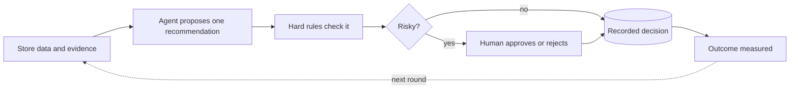
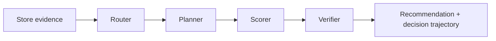
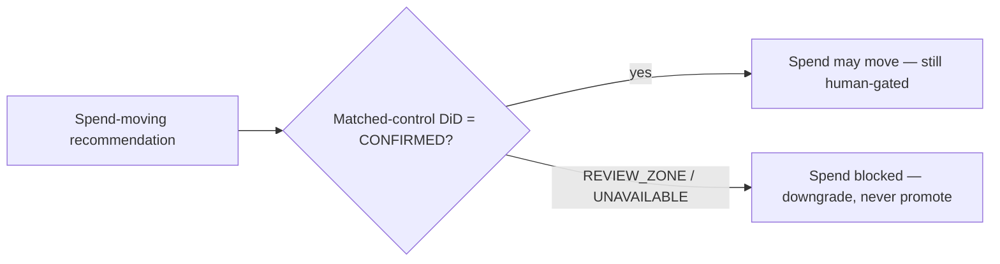

# Notion write-up kit — standard format

Paste order for the portfolio writeup. One flagship image, two Mermaid
diagrams, three tables. Notion renders `mermaid` code blocks natively
(code block → language: Mermaid).

---

## 1. Flagship overview (reuse what you have)

Use the existing README assets — they are already the standard format:

- `docs/images/architecture.png` — the detailed flagship render
- The "one-minute version" Mermaid flow from the README (hand-annotated,
  human gate in magenta)

If you want a single untouched copy for Notion, the one-minute flow is:

---

## 2. Decision pipeline detail

Explain each stage in one bullet underneath — not in the diagram:

- **Router** — picks the evaluation path: `no_data` · `near_deadline` · `standard`
- **Planner** — maps route to steps: `flag_for_review` · `score_and_recommend`
- **Scorer** — recovery %, velocity, health score, first-match decision chain
- **Verifier** — re-checks label, confidence range, reason, approval flag
- Run in fixed order; every stage stamped into the decision trajectory

---

## 3. The causal spend gate (the differentiator)

One worked example as prose under it: measured DiD prior +2.84%
(95% CI −0.5 … +6.2) admits zero → stays in REVIEW_ZONE → spend stays blocked.

---

## 4. Evidence inventory (table, not diagram)

| Input | Provides | What it cannot prove |
| --- | --- | --- |
| Store sales | actual + historical performance | — |
| Forecast data | expected performance (counterfactual arm) | intent; cannot prove outcome |
| Campaign audit | execution records, store universe, first-run timing | — |
| Matched controls | comparison stores (causal arm) | — |
| Costs and margins | financial context | — |

---

## 5. Decision vocabulary (table, not diagram)

| Class | Labels | Gate |
| --- | --- | --- |
| Recovery (no gate) | `CONTINUE`, `MONITOR` | none |
| Action | `EXTEND_INTERVENTION`, `ESCALATE`, `PAUSE_INTERVENTION`, `NEEDS_REVIEW` | human approval |
| Spend move | `RETARGET_SEGMENT`, `TIMING_SHIFT`, `REALLOCATE_BUDGET` | human approval **+** CONFIRMED DiD |

---

## 6. The three measurement arms (table, not diagram)

| Arm | Compares | Proves |
| --- | --- | --- |
| Recovery % | plan progress vs own target | plan progress only |
| Measured uplift | recent 14 days vs own 56-day baseline | change happened, not why |
| DiD (matched controls) | treated vs comparison stores | campaign effect — gate for spend |

---

## Status of the six decorative PNGs

Keep them out of the Notion writeup's main flow; if wanted at all, use one
full-width image (architecture.png) up top. The six layer PNGs can live in an
appendix/gallery section ("design system of the diagrams") or stay on GitHub
already pushed to `docs/layer-diagrams`.
