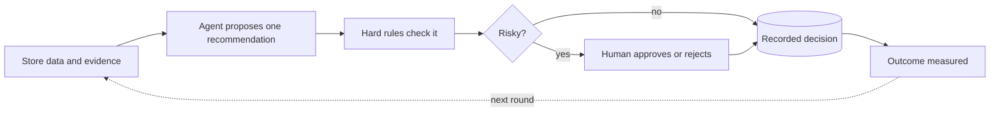

# Notion write-up skeleton — Retail Decision Intelligence Agent

How to use: paste headings in order, drop each block where marked.
PNG figures are in `~/Downloads/` (upload into Notion; Notion needs a manual
upload — files can't link from disk). Figures are numbered; captions are given,
writeup-standard style: *Figure N — caption.*

Page settings suggestion: full width, small text off; use toggle headings
(H2 + toggle) for the detailed sections.

---

## Page title + cover

**Title:** Retail Decision Intelligence Agent — deterministic store-recovery
decisions with causal guardrails and human oversight

**Callout (grey) under title:**
The brain is code, not a model call — every recommendation is recomputable by
hand, citable by ID, and approved by a human before any budget moves. An LLM
layer explains the evidence; it never decides.

---

## 0 · System at a glance

🖼 **Figure 1 — upload `architecture.png`** (or the README one-minute style —
pick one, not both, to keep the page fast)
Caption: *Figure 1 — End-to-end decision flow: evidence → deterministic
recommendation → guardrails → human gate → execution → measured outcome.*

One short paragraph (3–4 lines) in plain English: what store recovery means,
what the agent does per store, what the human gates.

---

## 1 · Data and Evidence Collection

**Body (2–3 sentences):** five inputs assemble into store-level evidence,
one store at a time; every artifact is a citable record (`rec:` / `outcome:` / `src:`).

**Block: evidence inventory table** (from notion-writeup-kit.md §4)

🖼 **Figure 2 — upload `layer-1-data-evidence.png`** (optional, green)
Caption: *Figure 2 — Evidence assembly: all five inputs converge per store;
forecast and matched-control arms are kept separate from day one.*

---

## 2 · Agent Orchestration

**Body:** one orchestrated agent, five fixed stages, pure code, no model calls;
stages stamp into a decision trajectory attached to each recommendation.

**Block: pipeline Mermaid** (kit §2)

**Bullet list:** Router → Planner → Scorer → Verifier one-liners (kit §2 bullets)

🖼 **Figure 3 — upload `layer-2-agent-orchestration.png`** (optional, indigo)
Caption: *Figure 3 — Fixed pipeline: route → plan → score → verify, with the
decision trajectory recorded at every stage.*

---

## 3 · Memory and Retrieval (off-path)

**Body (3–5 sentences, no diagram — keep this section textual):**
- BM25 over a curated corpus — retrieval supports explanation only
- the decision engine never imports retrieval; "BM25 informs, it never decides"
- failure asymmetry: pre-filter fails **open**, LLM layers fail **closed**
- without a key → deterministic template; advisory drafts never auto-apply
- numbers redacted before any external call

💡 Callout: *Retrieval is context for humans, never on the decision path.*

---

## 4 · Decision Engine and Guardrails

**Body:** deterministic first-match health chain; closed 9-label vocabulary;
spend only moves on a CONFIRMED matched-control DiD; diagnostics downgrade,
never promote.

**Block: causal spend-gate Mermaid** (kit §3)

**Block: decision vocabulary table** (kit §5)

**Block: worked-example callout (amber):**
Measured DiD prior +2.84% (95% CI −0.5 … +6.2) admits zero → the guardrail
blocks the spend instead of dressing the estimate up.

🖼 **Figure 4 — upload `layer-4-decision-guardrails.png`** inside a **toggle**
("Full decision-flow diagram") so the page stays clean; amber.
Caption: *Figure 4 — Full decision flow: health chain, evidence states, causal
spend gate, verifier re-check.*

---

## 5 · Tools and Human Approval

**Body:** the human gate is structural (fail-closed 503 in code, enforced twice:
guardrails + verifier re-run at decision time); one execution per approval
(idempotency key), dry-run default; reversible / cautious / irreversible risk
tiers frame the reviewer's choice; append-only ledger, journal, `decided_by`.

**Block: three-lane responsibilities table** (activities — not the swimlane PNG)

| AI decision system | Tools | Human reviewer |
| --- | --- | --- |
| proposes + validates (double gate) | fetches data (read-only), executes gated | approves or rejects |
| records to append-only ledger | one run per approval, dry-run default | oversight: audit trail, attention queue |

🖼 **Figure 5 — upload `layer-5-tools-human-approval.png`** (magenta swimlane),
inside a **toggle** if the page feels long.
Caption: *Figure 5 — Responsibilities across three lanes; the human is the only
actor who can turn a recommendation into an execution.*

---

## 6 · Outcome Monitoring and Evaluation

**Body:** the closed loop returns to the business objective — recovery within
the 60-day window (56-day own baseline, final 14-day recent window). After each
intervention the system re-measures all three arms and folds the verdict into
the next decision round. The loop closes when a second decision provably differs
because of measured evidence. Between rounds: 23 pinned golden cases in CI gate
any behavior change.

**Block: three measurement arms table** (kit §6)

🖼 **Figure 6 — upload `layer-6-outcome-monitoring.png`**
Caption: *Figure 6 — Closed loop: recommend → approve → execute → measure →
re-decide, pinned by golden cases in CI.*

---

## 7 · Evaluation and reliability (closing section)

**Body:** evaluation as a first-class citizen — 23 pinned golden scenarios,
grounding-failure evals, provider-swap evals in CI; time-lagged non-circular
reliability (Spearman ρ of scores vs later measured outcomes); confidence is a
ranking heuristic, not a calibrated probability (say it plainly).

Optional closing callout: *measurement over vibes — every claim carries a
confidence and a citation.*

---

## Appendix A · Diagram gallery (optional)

If you want to show the single-hue diagram system as a design artifact:

🖼 `layer-1` … `layer-6` thumbnails in a 2×3 gallery grid, one caption line each
(color legend: green = main data path · indigo = pure-code engine ·
slate dashed = off-path · amber = guardrails/risk · magenta = human gate).
Source: branch `docs/layer-diagrams` on GitHub, `docs/images/layer-*.png`.

---

## Appendix B · Raw figure URLs (if you prefer linked images)

Branch `docs/layer-diagrams` (public):

- https://raw.githubusercontent.com/ashishkumar-ds/retail-decision-intelligence-agent/docs/layer-diagrams/docs/images/layer-1-data-evidence.png
- https://raw.githubusercontent.com/ashishkumar-ds/retail-decision-intelligence-agent/docs/images/layer-2-agent-orchestration.png (…same pattern through layer-6)
- Architecture flagship: `docs/images/architecture.png` on `main`.
